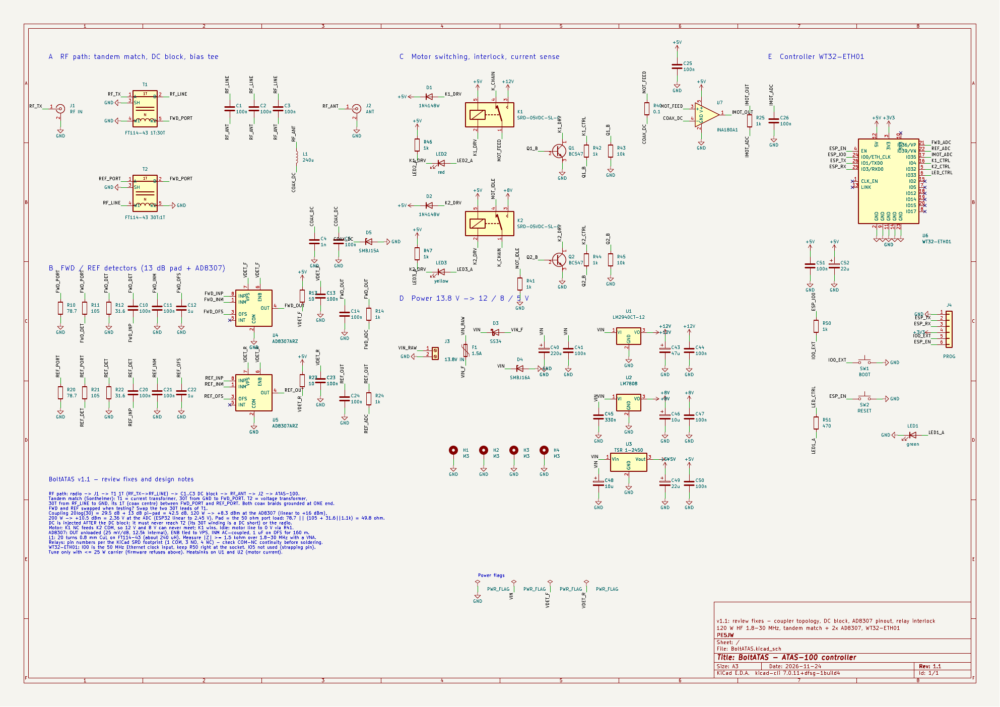
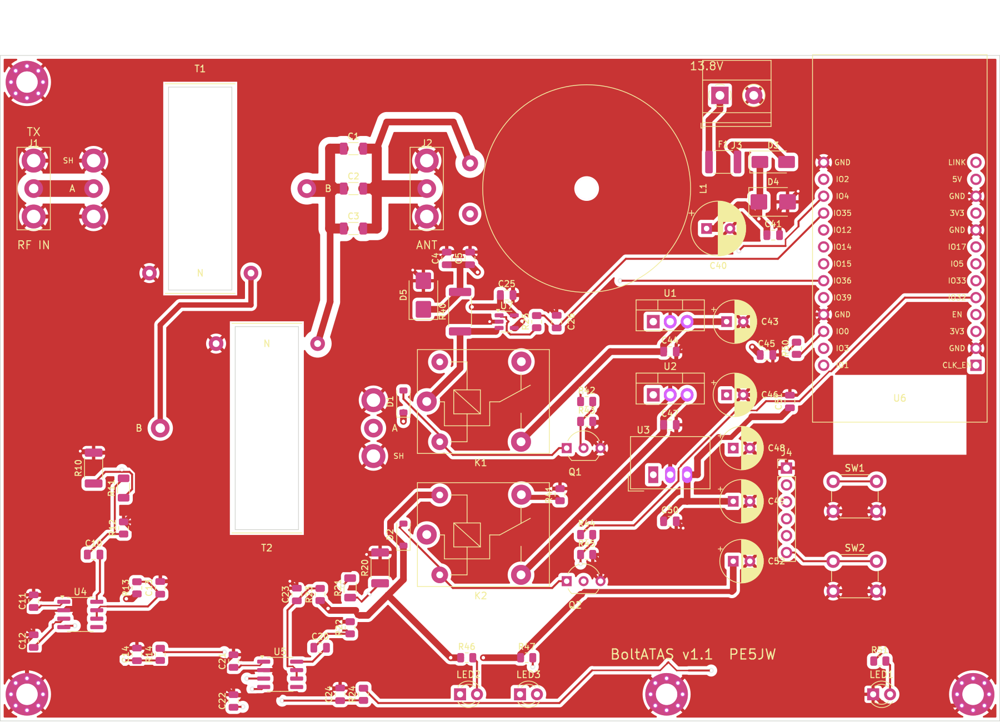

# BoltATAS

Netwerkcontroller voor de Yaesu **ATAS-100** motorantenne op de FT-897D, op basis van een **WT32-ETH01** (ESP32 + Ethernet).
Meet vooruit- en reflectievermogen (tandem match + 2× AD8307), stuurt de antennemotor via de DC-spanning op de coax
en stemt zelfstandig af op de laagste SWR. Bediening via een HTTP API in BoltSwitch-stijl.

PE5JW — hardware/firmware v1.1 (2026-11-24)

> **Status:** ontwerp en firmware zijn met tools gecontroleerd, maar er is nog **niets gebouwd of op de band getest**.
> - Schema: de netlist is door KiCad zelf geëxporteerd en vergeleken met de onderdelenlijst. Daarbij zijn de pin-types gecontroleerd.
> - PCB: DRC geeft 0 fouten, alle verbindingen zijn gerouteerd.
> - Firmware: de afstemlogica is getest in een simulatie (9000 runs). De Ethernet/WiFi-wisseling is getest tegen stubs voor arduino-esp32 core 2.x en 3.x.
>
> Zie [Open punten](#open-punten) voor wat je bij de bouw moet nameten.



## Mappen

| Map | Inhoud |
|---|---|
| `hardware/` | KiCad 7 project: `BoltATAS.kicad_sch`, `.kicad_pcb`, `.kicad_pro`, `.kicad_dru`, projectbibliotheek (`BoltATAS.kicad_sym`, `BoltATAS.pretty/`) |
| `hardware/fab/` | Gerbers + boorbestanden (`BoltATAS-gerbers.zip`), BOM (`BoltATAS-BOM.csv`), pick&place |
| `hardware/tools/` | Python-generators voor bibliotheek, schema en PCB, netlist-check, DRC, `build_all.sh` |
| `firmware/BoltATAS/` | Arduino sketch (`BoltATAS.ino`) + platformonafhankelijke logica (`AtasCore.h`) |
| `firmware/test/` | Simulatie van autotune/motor en test van de netwerkwisseling (draait op een PC) |
| `docs/` | Schema als PDF/PNG, PCB-renders, DRC-rapport |

## Hardware

```
FT-897D ─ J1 ─ T1 (stroomtrafo) ─ RF_LINE ─ C1..C3 (DC-blok) ─ RF_ANT ─ J2 ─ ATAS-100
                    │                  │                          │
               FWD_PORT ── T2 (spanningstrafo, 30T naar GND)      L1 RF-choke
                    │      1T tussen FWD_PORT en REF_PORT          │
             13 dB pad → AD8307 → IO36            COAX_DC ← R40 0.1 Ω ← K1/K2 relais ← 12 V / 8 V
             REF: 13 dB pad → AD8307 → IO39             INA180 → IO35 (motorstroom)
```

- **Tandem match** (Sontheimer): twee FT114-43 kernen, 1:30. T1 = stroomtrafo (1 winding = coax-ziel RF_TX→RF_LINE, 30 wdg van GND naar FWD_PORT). T2 = spanningstrafo (30 wdg van RF_LINE naar GND, 1 winding = coax-ziel tussen FWD_PORT en REF_PORT).
- **Koppeling** 29,5 dB + 13 dB π-pad = 42,5 dB. 120 W geeft +8,3 dBm op de AD8307 (lineair tot +16 dBm) en 2,31 V op de ADC; 200 W geeft 2,36 V (ESP32 lineair tot 2,45 V).
- **DC-blok** C1..C3 (3× 100 nF X7R 100 V) ligt tussen koppelaar en bias-tee. Er komt dus geen 8/12 V op de zender, en ook niet op T2 (diens 30 wdg zijn voor DC een kortsluiting).
- **Bias-tee** L1: 20 wdg 0,8 mm CuL op FT114-43 (≈240 µH).
- **Motor:** K1 (12 V = langer = frequentie omlaag) en K2 (8 V = korter = frequentie omhoog). Het NC-contact van K1 voedt de COM van K2, zodat 8 V en 12 V elkaar nooit kunnen raken. In rust ligt de lijn via R41 op 0 V.
- **Motorstroom:** 0,1 Ω + INA180A1 (2 mV/mA) op IO35. Daarmee detecteert de firmware kortsluiting (> 900 mA) en een open lijn (< 10 mA).
- **Voeding:** 13,8 V → PTC 1,5 A → SS34 (ompoolbeveiliging) → TVS.
  - LM2940CT-12: low-dropout, want een LM7812 valt bij 13,3 V uit regeling.
  - LM7808.
  - Traco TSR 1-2450: een schakelende 5 V; een LM7805 is pin-compatibel, maar heeft dan een koelplaat nodig.

### Pinnen WT32-ETH01

| GPIO | Functie |
|---|---|
| IO36 | ADC FWD (AD8307 U4) |
| IO39 | ADC REF (AD8307 U5) |
| IO35 | ADC motorstroom |
| IO4 | K1, 12 V, antenne langer |
| IO32 | K2, 8 V, antenne korter |
| IO33 | status-LED |
| IO0 | Ethernet-klok (50 MHz). Alleen via R50 naar BOOT-knop/header |

Ethernet gebruikt IO0, 16, 18, 19, 21–23 en 25–27. IO5 wordt niet gebruikt: dat is een strapping-pin die tijdens het booten schakelt.

### Bouwnotities

1. **Toroids T1/T2:** elke kern staat rechtop in een sleuf in de print, met een stukje RG-58/RG-400 (±60 mm) er recht doorheen.
   - Ziel aan pad A en B. Mantel **aan één kant** solderen (pad SH, kant A); aan de andere kant de mantel afknippen.
   - T2 krijgt de volle lijnspanning: wikkel de 30 windingen met PTFE- of dubbel gelakt draad.
   - De kernen steken ±12 mm onder de print uit, dus gebruik afstandsbussen van ≥ 15 mm.
2. **FWD en REF verwisseld?** Draai de twee draden van de 30 windingen van T1 om.
3. **L1:** meet met een NanoVNA dat |Z| ≥ 1,5 kΩ is over 1,8–30 MHz. Haal je dat niet, voeg dan een tweede choke in serie toe.
4. **Relais:** de pinnummers volgen de KiCad SRD-footprint (1 COM, 3 NO, 4 NC). Controleer vóór het solderen met een multimeter dat COM–NC doorgang heeft.
5. **U1/U2** krijgen een klein koelplaatje, want ze voeren de motorstroom.
6. **WiFi:** de antenne van de WT32-ETH01 zit aan het eind tegenover de RJ45. Daaronder zit geen koper (keep-out). In een metalen kast werkt WiFi nauwelijks; gebruik dan Ethernet of een kunststof deksel.
7. Gerbers staan in `hardware/fab/BoltATAS-gerbers.zip`. Board: 150 × 100 mm, 2 lagen, 1,6 mm. De sleuven zitten in Edge.Cuts.



## Firmware

**Bouwen:** Arduino IDE of arduino-cli.
- Board: "WT32-ETH01 Ethernet Module" (of "ESP32 Dev Module").
- Core: arduino-esp32 2.0.x of 3.x.
- Bibliotheek: ArduinoJson 6.21+ of 7.x.

Kopieer `firmware/BoltATAS/secrets.h.example` naar `secrets.h` en vul de WiFi- en OTA-gegevens in.

**Netwerk** (één van beide, nooit allebei):
- Ethernet heeft voorrang.
- WiFi start pas als er na het opstarten 4 s geen kabel is, of 5 s nadat de kabel eruit is getrokken.
- Wordt een kabel ingeplugd, dan gaat WiFi direct uit (al bij link-up, nog vóór DHCP).
- Krijgt Ethernet 20 s lang geen DHCP-adres, dan valt de module terug op WiFi.
- Naam op het netwerk: mDNS `boltatas.local`. OTA-updates werken met wachtwoord.

**Status-LED:**
- aan: Ethernet
- 1 Hz: WiFi
- 4 Hz: geen netwerk
- 8 Hz: aan het afstemmen
- dubbele flits: motorfout

### HTTP API

Alle verzoeken zijn GET en geven JSON terug, met CORS open.

| Endpoint | Functie |
|---|---|
| `/status` | SWR, FWD/REF in W en dBm, return loss, motorstroom, motorfout, tune-status, netwerk |
| `/up` `/down` | Motor draaien tot `/stop`, maximaal 15 s |
| `/up?ms=N` `/down?ms=N` | Motor N ms laten draaien (10…15000) |
| `/stop` | Motor stoppen en lopende afstemming afbreken |
| `/tune` | Autotune starten. Vereist een draaggolf van 0,5–25 W |
| `/tune?target=1.5&dir=up` | Doel-SWR (1.1–3.0) en beginrichting. Gebruik `dir=up` als de frequentie omhoog ging |
| `/cal` | Kalibratie tonen |
| `/cal?fwd_w=10` | FWD-koppeling instellen op een bekend vooruitvermogen (dummy load + referentiemeter) |
| `/cal?ref_w=10` | REF-koppeling instellen: voed hiervoor RF in via de ANT-aansluiting |
| `/cal?travel_ms=45000` | Looptijd van de antenne van eindstop tot eindstop (zelf meten) |

`/up` en `/down` breken een lopende autotune af.

**Autotune** werkt in twee fasen:
1. **Sweep:** de motor draait continu en de RF wordt elke 40 ms bemonsterd.
2. **Fijn zoeken:** stapsgewijs, met een halvering van de stapgrootte bij elke omkering. Daarna gaat de antenne terug naar de beste positie.

De firmware **weigert te tunen boven 25 W**, omdat het bewegen van de spriet onder vol vermogen de contacten kan doen vonken. Hij stopt ook bij verlies van RF en bij een motorfout.

## Tests

```bash
cd firmware/test
ARDUINOJSON_SRC=/pad/naar/ArduinoJson/src ./run_tests.sh
```

- **`sim_test`:**
  - RF-rekenwerk, de motor-interlock en de dode tijd tussen relais.
  - Autotune tegen een gesimuleerde ATAS-100, met willekeurige resonantie, startpositie, voetpuntweerstand, coaxverlies, motoruitloop en detectorruis.
  - 3 × 3000 runs: 0 gemist, 0 time-outs.
  - Gemiddeld 40 s zonder richtingshint en 13 s met hint.
- **`net_test`:** de Ethernet/WiFi-wisseling. Getest scenario's: geen kabel, inpluggen, uittrekken, geen DHCP en late DHCP. Draait tegen stubs met de API van core 2.x en 3.x.

## KiCad-bestanden opnieuw genereren

Het schema en de PCB worden gegenereerd uit `hardware/tools/`. Benodigd: KiCad 7 (`kicad-cli` en de pcbnew-Python-module), Java 25 en `freerouting-2.5.0.jar`.

```bash
FREEROUTING=/pad/freerouting-2.5.0.jar JAVA=java hardware/tools/build_all.sh
```

Dit draait de volgende stappen achter elkaar: bibliotheken → schema → netlist via KiCad → vergelijking met de onderdelenlijst → plaatsing → autorouter → GND-vlakken → DRC.

Handmatige aanpassingen in KiCad zelf mogen gewoon, maar die worden bij een volgende generatorrun overschreven.

## Wijzigingen t.o.v. v1.0 (review)

v1.0 had geen bruikbare KiCad-bestanden: het schema bevatte geen draden of symbooldefinities, en de PCB had geen sporen, verkeerde footprints en overlappende onderdelen. De belangrijkste inhoudelijke fouten:

1. **Tandem match:** T2 zat in serie met de lijn in plaats van als spanningstrafo over de lijn. Daardoor was de koppelaar niet richtingsgevoelig en werkte de SWR-meting niet.
2. **DC-blok ontbrak:** de 8/12 V kwam op de antenne-uitgang van de FT-897D.
3. **AD8307 verkeerd aangesloten:**
   - OUT (pin 4) aan GND, ENB (pin 6) als uitgang gebruikt en INM DC aan massa.
   - De 4k7-load verlaagde de slope van 25 naar ±6,8 mV/dB.
   - Een condensator op OFS ontbrak; zonder die condensator ligt de hoogdoorlaatgrens op ±700 kHz.
4. **Overbelasting bij 120 W:** de detector kreeg +21 dBm (max. +16). Opgelost met een 13 dB pad.
5. **Kortsluiting via relais:** het rustcontact van K1 lag aan GND terwijl K2 8 V op hetzelfde punt zette. Nu met hardware-interlock.
6. **RF-choke te klein:** 10 wdg op een FT50-43 is ±52 µH (niet 100 µH) en zit dicht bij verzadiging.
7. **Firmware:**
   - `ETH.begin()` zonder de WT32-instellingen (PHY-adres 1, power GPIO16), waardoor Ethernet niet startte.
   - De tune-loop stopte na één stap.
   - Blocking delays tot 5 s, waardoor `/stop` niet werkte terwijl de motor draaide.
   - Geen afbreken bij verlies van RF.
8. **GPIO5 vervangen door IO32 voor K2:** GPIO5 is een strapping-pin die tijdens het booten schakelt.

## Open punten

- **ATAS-100 spanningen en richting** (8 V korter / 12 V langer) zijn overgenomen uit de projectoverdracht. Controleer dit met de handleiding of een meting aan de FT-897D.
- **Motorstroom van de ATAS:** stel `MOTOR_OPEN_MA` en `MOTOR_SHORT_MA` in de sketch bij na een meting; de waarde is ook af te lezen via `/status`.
- **Looptijd eindstop-tot-eindstop** meten en instellen met `/cal?travel_ms=`.
- **AD8307:** de intercept spreidt enkele dB per exemplaar. Kalibreer met `/cal?fwd_w=` en `/cal?ref_w=`.
- **SRD-relais:** controleer NO/NC (zie bouwnotitie 4).
